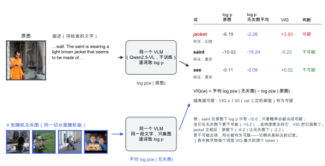
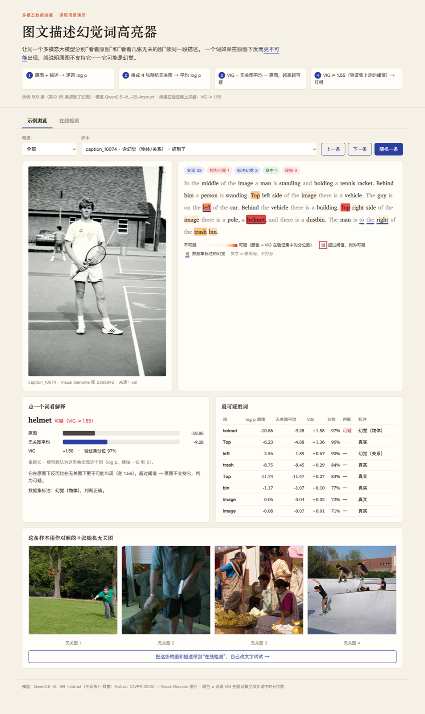
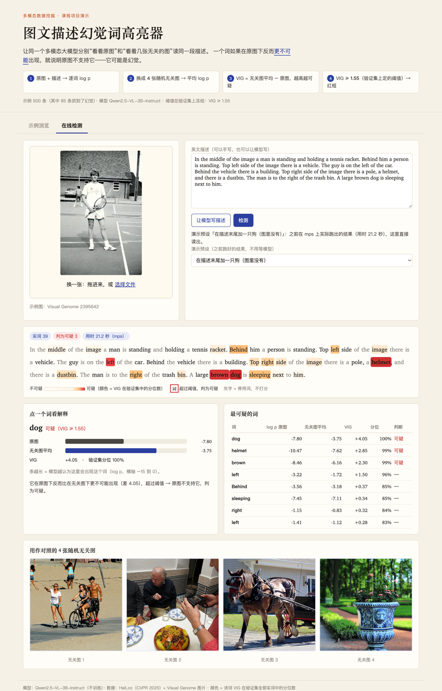

# halloc-vig：图文描述幻觉词的免训练定位

**Training-free, word-level hallucination localization for image descriptions via image-swap contrast (Visual Information Gain).**

多模态数据挖掘课程项目。让同一个多模态大模型（Qwen2.5-VL）分别“看着原图”和“看着几张随机无关的图”读同一段描述，逐词比较对数概率：一个词在原图下反而比在无关图下更不可能出现，说明原图不支持它，可能是幻觉。全程**不训练任何模型**，输出到**词**这一级，并能解释每个判断。



## 方法

给定图片 $I$、提示语 $q$、描述 $w_1 \dots w_n$，从同一数据池随机抽 $K$ 张无关图 $I'_1 \dots I'_K$，定义 token 级视觉信息增益（越高越可疑）：

$$\mathrm{VIG}(w_t) = \frac{1}{K}\sum_{k=1}^{K} \log p(w_t \mid I'_k, q, w_{<t}) - \log p(w_t \mid I, q, w_{<t})$$

- 词分数取词内 VIG 最大的 token；停用词不打分。
- 每条描述只需 K + 1 次前向（默认 K = 4），不需要反向传播或额外标注。
- 罕见但真实的词（原图下概率也很低）在无关图下通常更低，VIG 为负，不会误报；这是它比“只看概率”好的原因。

## 结果

数据：[HalLoc](https://huggingface.co/datasets/uunicee/HalLoc)（CVPR 2025）图像描述子集，图片来自 Visual Genome。所有选择和阈值只在 val 上确定，test 全部 6,546 条（160,509 个实词）只跑一次。指标为实词级，核心词口径（每条幻觉只标被改动的那个词），区间为按样本 bootstrap 的 95% 区间。

| 方法（Qwen2.5-VL-3B） | PR-AUC [95% 区间] | ROC-AUC | 关系类 ROC-AUC |
| --- | --- | --- | --- |
| **VIG，4 张随机无关图** | **0.142** [0.135, 0.151] | 0.735 | **0.724** |
| nll + VIG（标准化后相加） | 0.112 [0.106, 0.117] | **0.769** | 0.664 |
| 只看概率（nll） | 0.074 [0.070, 0.077] | 0.712 | 0.550 |
| 熵 | 0.059 [0.056, 0.063] | 0.598 | — |
| 随机 | 0.034 | 0.5 | 0.5 |

开发过程中的几个发现（val）：
- **对照图要用随机的真实图片**：灰图、不给图这类“空白”对照并不比只看概率好；CLIP 检索出的相似图反而比随机图差（相似图和原图“缺的东西”一样，信号被抵消），要 8 张才追平。
- 随机图 **4 张就饱和**（PR-AUC：1 张 0.144 → 4 张 0.167 → 8 张 0.166）。
- 换 7B 后 ROC-AUC 显著提高（+0.056），但 PR-AUC 没有提高。
- 局限：抓不住同一场景内的细粒度替换（如 tennis racket → baseball bat）；用同一个模型检查它自己写的描述基本无效。

## 演示网页

FastAPI 后端 + 原生 HTML/CSS/JS 前端，只在本机运行：示例浏览（逐词上色、点击单词看“原图 vs 无关图”的概率对比）、上传任意图片在线检测、让模型写描述再检测。

| 示例浏览 | 在线检测（在描述里加一只图中没有的狗） |
| --- | --- |
|  |  |

## 目录

```
pyproject.toml              依赖
src/
  download_vg_images.py     按需下载 HalLoc 用到的 Visual Genome 图片，校验后保存，可续传
  vig_score.py              逐 token 打分：原图 + 对照（blank 灰图 / noimg 不给图 / other:K 随机图 / near:K 近邻图）
  clip_neighbors.py         CLIP ViT-L/14 图像向量，同一切分内找近邻图
  eval_words.py             聚合到词；官方 / 核心词两种标签口径；PR-AUC、ROC-AUC、分类型、样本级
  final_eval.py             fit：在 val 上冻结阈值与标准化常数；apply：原样用到 test，带 bootstrap 区间
  compare_models.py         两个模型的配对比较
  analyze_multi.py、viz_*.py、collect_numbers.py      图表与结果汇总
  run_*.sh                  各组实验的运行脚本
  demo/                     演示网页（core.py、server.py、static/）
```

## 安装与数据

```bash
uv sync          # Python ≥ 3.11；Linux 上从 PyTorch cu128 源安装 torch / torchvision
```

1. 从 [HalLoc](https://huggingface.co/datasets/uunicee/HalLoc) 下载 `halloc_caption.json`、`halloc_instruct.json`、`halloc_vqa.json`、`qa_database.json`，放到 `data/`。
2. 从 Visual Genome 官网下载图片元数据 `image_data.json.zip`（https://homes.cs.washington.edu/~ranjay/visualgenome/data/dataset/image_data.json.zip），解压得到 `image_data.json`，放到 `data/vg_meta/`。
3. `uv run python src/download_vg_images.py`：下载 val + test 用到的约 4,323 张图片（约 574 MB）。
4. 模型：Qwen2.5-VL-3B-Instruct / 7B-Instruct（Hugging Face 或 ModelScope），用 `--model 本地路径` 指定。3B 推理约需 10 GB 显存，7B 约 19 GB。

## 运行

```bash
# 1. 开发（只用 val）
uv run python src/vig_score.py --model <模型路径> --subset caption --split val --n 500 --seed 0 \
    --controls other:8 --out results/val_3b
uv run python src/eval_words.py results/val_3b --labels core
uv run python src/eval_words.py results/val_3b --labels official

# 2. 在 val 上冻结阈值（主方法：VIG，4 张无关图）
uv run python src/final_eval.py fit --method 3B_vig4 --run results/val_3b --score vig_other4@max \
    --protocol results/protocol.json

# 3. test 只跑一次，按冻结协议评测
uv run python src/vig_score.py --model <模型路径> --subset caption --split test --n 0 --seed 0 \
    --controls other:4 --out results/test_3b
uv run python src/eval_words.py results/test_3b --labels core
uv run python src/eval_words.py results/test_3b --labels official
uv run python src/final_eval.py apply --method 3B_vig4 --run results/test_3b \
    --protocol results/protocol.json --out results/final

# 4. 演示网页（用第 1、2 步的结果作为示例和阈值），然后打开 http://127.0.0.1:8000
uv run python src/demo/server.py --model <模型路径> --val-run results/val_3b \
    --examples val=results/val_3b --protocol results/protocol.json
```

近邻图对照：先运行 `src/clip_neighbors.py`，再给 `vig_score.py` 加 `--controls near:8 --nn-file <近邻 JSON>`。各脚本参数见 `--help`。

## 引用的工作

- E. Park, M. Kim, G. Kim. HalLoc: Token-level Localization of Hallucinations for Vision Language Models. CVPR 2025.
- R. Krishna et al. Visual Genome. IJCV 2017.
- Qwen Team. Qwen2.5-VL Technical Report. 2025.
- S. Leng et al. Mitigating Object Hallucinations in Large Vision-Language Models through Visual Contrastive Decoding. CVPR 2024.

数据集与模型权重不随本仓库分发，使用时请遵守各自的许可。

## 许可

代码以 [MIT](LICENSE) 许可发布。
